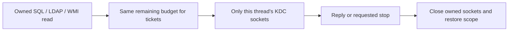

# Stop controls during DNS and Kerberos setup

Implemented October 29, 2026 within the approved collection-controls work.
This record covers one feature checkpoint, not the initiative's final acceptance.

## Problem and decision

SQL and LDAP connections can ask a domain controller for a Kerberos ticket before
they authenticate. That request uses a separate connection. Closing the SQL or
LDAP connection cannot wake a blocked ticket request. The installed impacket
0.13.1 ticket transport has no timeout argument and does not explicitly release
all of its sockets. DNS and alternate address attempts can also consume more
time than a timeout applied only to the final connection.

Keep the existing authentication provider and add ownership of just those Python
connections. An opted-in caller's budget and stop event follow the read into DNS
and ticket acquisition. A stop closes only owned Python sockets, retains complete
results and waits for actual cleanup. No process or forcibly ended thread is
introduced. Windows sign-on/domain locator calls and provider cleanup can still
overrun; an exact process-exit deadline is not promised.

Rewriting the ticket protocol or cryptography was not selected. Neither were a
process-wide default socket timeout, replacing the global socket class for ticket
requests, or retaining the earlier process-worker credential transfer machinery.
They would affect unrelated callers, duplicate provider code or retain an unused
credential serialization path. Provider arguments alone were investigated: the
installed `getKerberosTGT`/`getKerberosTGS` have no transport/timeout parameter.

## Implementation

[operations.py](../../src/openhound_collector_common/clients/operations.py) keeps
the innermost `ReadOperation` in a scoped `ContextVar`. Each thread has its own
value. Entry records the scope; exit joins its monitor and restores the previous
scope in a `finally` block, including on failure. A nested read gets only its
parent's remaining time and shared stop event. `remaining()` consistently reports
a stopped read if time expires between checking and reading the clock.

[kerberos_io.py](../../src/openhound_collector_common/clients/kerberos_io.py)
supplies `kerberos_exchange(control=None)`. An explicit control can bound keytab
preparation before workers start. Otherwise it inherits a currently opted-in
SQL/LDAP/WMI read; with no such caller it leaves the provider policy unchanged.
Nested ticket helpers share the same owned exchange.

Impacket stores its networking tools in the module-local name `kerberosv5.socket`.
A small scoped adapter replaces that reference, not the standard-library module.
The installed transport uses only `SOCK_STREAM`, `error`, `getaddrinfo`, and
`socket`. The adapter delegates unrelated threads normally. Controlled threads
register their own sockets before use, set the remaining timeout and keep them
until cleanup, including after connection or provider parsing failures. A stop
shuts down and closes those sockets; Windows timed receives need both operations.
Ticket encoding, encryption, request/reply parsing and account rejection remain
in impacket. A guarded count keeps the adapter installed while any controlled
exchange is active and restores the exact original reference after the last one.
Another integration replacing that reference is refused visibly rather than
overwritten silently. Failed socket release or failed restoration is fatal.



[kerberos.py](../../src/openhound_collector_common/clients/kerberos.py) wraps
loaded-identity ticket selection and exposes
`KerberosCredentials.prepare(..., read_control=...)`. [auth.py](../../src/openhound_collector_common/clients/auth.py)
does the same for password/hash ticket creation. Explicit keys still request a
TGT once, with failure remembered. A socket timeout is an intentional stopped
read only for an opted-in scope; ordinary consumers keep their prior policy.
This distinction includes Windows millisecond rounding, which can return a
socket timeout just before the monotonic clock reaches its recorded deadline.
Fatal cleanup is never relabelled as an ordinary stop. The unused process-worker
`CredentialSource`, source-transfer fields/method and TGT-to-base64 transfer were
removed. Clients retain the validated identity/tickets directly in memory.

[discovery/dns.py](../../src/openhound_collector_common/discovery/dns.py) accepts
an optional `read_control` on `make_resolver`. Its per-instance wrapper uses
dnspython's public `lifetime` argument and honors a shorter parent budget. It
checks stop requests before/after the query and rejects a late answer. It does
not close provider-owned DNS handles: a stop can wait for the bounded in-flight
round trip. With no control the original resolver behavior remains; proxy mode
still forces TCP, including when a call explicitly supplies `tcp=False`.

[discovery/network.py](../../src/openhound_collector_common/discovery/network.py)
passes optional DNS controls through `network_session`. `resolve_socket_addresses`
uses the selected resolver and parent time; a standalone controlled client gets
its own bounded resolver. Numeric conversion requests no DNS. A selected resolver
miss never falls through to a different system DNS service. `check_tcp_port`
accepts a control and gives DNS plus every address attempt one elapsed budget.
Its socket contexts close only newly created, exclusively owned connections;
unexpected close failure remains fatal.

MSSQL opts in with its run event. DNS calls use at most five seconds, tightened
by a smaller connection/read/target budget. `--port-check-timeout` includes DNS
and alternate addresses for a TCP probe, or DNS plus the direct SQL Browser read.
The Browser UDP socket uses the same owned stop/cleanup boundary and cannot run
through a TCP-only SOCKS route. Python ticket traffic during SQL/LDAP/WMI inherits
that operation's budget. Each keytab preflight uses `--connect-timeout`.
A resource stop during setup is translated back to the saved run's safe reason
and status even before any target has started. No graph/schema change is involved.

## Effects on other consumers

No new dependency is added. Existing SCCM adapters do not supply these controls,
so their timeout defaults, authentication ladder, DNS selection and output policy
remain unchanged. Shared helper calls without a control delegate normally, even
while a different controlled thread has the ticket adapter installed. SCCM's
architecture records this boundary.

Recommendation for a separate SCCM change: opt its long-running Windows network
reads into the same controls once its desired timeout/partial-result policy is
reviewed. This would address the same otherwise unbounded Python KDC waits without
adding a process. That behavior change is not silently enabled here.

## Evidence and manual verification

Common's full suite passed **467 tests**, with one explicit Python-version skip.
The affected SQL setup/target/resource selection passed **66 tests**. SCCM's
affected WMI, HTTP auth, EPA, DNS/proxy, AD and real DLT selection passed **75**.
Shared and SQL lint/type checks passed at the feature boundary; final formatting
and type-only adjustments retain the same runtime behavior.

Real impacket `sendReceive` tests connect only to owned loopback fixtures. They
cover silent/trickling peers, partial framing errors, successful replies, run-stop
requests, different simultaneous deadlines, nested scopes, unrelated uncontrolled
calls, cleanup failure and exact provider restoration. DNS tests cover positional
and keyword lifetime/TCP arguments, remaining parent time, ordinary NXDOMAIN and
late answers. A real UDP Browser fixture proves a stop wakes the wait. A TCP probe
fault proves it closes only its connection and tries no second address afterward.
Fatal cleanup has separate coverage.

Two earlier timing assumptions were corrected after checks on a heavily loaded
Windows host. The SQL no-late-cancel test now gives an immediately ready read
250 ms and waits 300 ms before reusing its connection. The LDAP preserved-page
test requests a stop after the second page starts, rather than assuming the
first page always arrives inside 100 ms. Actual elapsed-deadline cases remain.
These affect tests only; production budgets are unchanged.

The read-only lab check `tests/kerberos_setup_lab.py` in the private task directory
passed password TGT/TGS acquisition, controlled RC4 keytab preparation, and SQL,
LDAP and WMI reads with that validated identity. It then confirmed both the
provider reference and read scope were restored. Temporary credentials were
removed. `kerberos-setup-live.json` contains safe results and no credentials.
No lab service, object or policy was changed. This does not replace the final
credential/proxy/platform or Go-reference acceptance matrix.

In the declared environments, with fresh short Windows temporary paths:

```powershell
# Common
uv run pytest tests/test_kerberos_io.py tests/test_dns_read_controls.py tests/test_network_session.py tests/test_kerberos_credentials.py tests/test_ldap_kerberos.py -q
uv run ruff check src tests
uv run mypy src

# MSSQL
uv run pytest tests/unit/test_browser.py tests/unit/test_target_collection.py tests/unit/test_network_wiring.py tests/unit/test_collection_outcomes.py tests/unit/test_resource_limits.py tests/unit/test_credential_inputs.py tests/unit/test_collection_failure_controls.py -q

# SCCM
uv run pytest tests/wmi_client_test.py tests/http_auth_test.py tests/mssql_epa_test.py tests/ad_auth_warnings_test.py tests/dns_resolver_flag_test.py tests/proxy_dns_test.py tests/ldap_resolved_principals_test.py tests/ldap_resolved_principals_dlt_test.py -q
```

For a normal authorized lab run after the reviewed shared release:

```powershell
uv run openhound collect mssql .\setup-check --targets ps1-db.mayyhem.com:1433 --domain mayyhem.com --dc 10.10.10.100 --connect-timeout 15 --port-check-timeout 2 --query-timeout 30 --ldap-timeout 30 --target-timeout 600 --run-all --clean
Get-Content .\setup-check\collection-status.json
```

Use the owned local fixtures for forced stalls, rather than changing the lab KDC
or service configuration. The provider integration was verified against
impacket 0.13.1's installed [`kerberosv5.py`](https://github.com/fortra/impacket/blob/impacket_0_13_1/impacket/krb5/kerberosv5.py)
and dnspython's documented [Resolver lifetime API](https://dnspython.readthedocs.io/en/stable/resolver-class.html#dns.resolver.Resolver.resolve).
Future provider changes need these regression checks; do not assume a different
transport implementation has the same four-name boundary.

## Review and commit suggestions

Suggested common message: `Bound owned Kerberos and DNS setup reads`.
Suggested SQL message: `Apply setup budgets through discovery and authentication`.
Review the complete overlapping files together with earlier read/resource work.
The owner stages and commits manually; the agent has not staged, committed,
tagged, pushed or published. Example commands after owner review:

```powershell
# Common
git add src/openhound_collector_common/clients/operations.py src/openhound_collector_common/clients/kerberos_io.py src/openhound_collector_common/clients/kerberos.py src/openhound_collector_common/clients/auth.py src/openhound_collector_common/discovery/dns.py src/openhound_collector_common/discovery/network.py tests/test_kerberos_io.py tests/test_dns_read_controls.py tests/test_network_session.py tests/test_ldap_read_controls.py tests/test_sql_read_controls.py README.md docs/changes/2026-10-29-connection-setup-limits.md
git commit -m "Bound owned Kerberos and DNS setup reads"

# MSSQL
git add src/openhound_mssql/auth.py src/openhound_mssql/main.py src/openhound_mssql/network.py src/openhound_mssql/collection/run.py src/openhound_mssql/collection/browser.py src/openhound_mssql/extension.yaml tests/unit/test_browser.py tests/unit/test_resource_limits.py README.md ARCHITECTURE.md docs/changes/2026-10-23-feature-completion-status.md
git commit -m "Apply setup budgets through discovery and authentication"
```

SCCM's documentation-only boundary note belongs with its reviewed consumer
updates. The final single common release and published dependency acceptance
remain required work; no release number is guessed in this feature.
